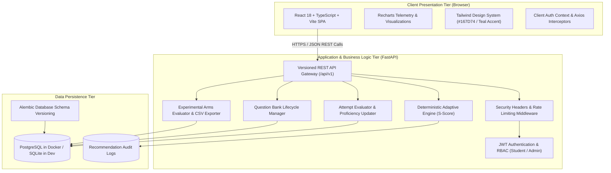
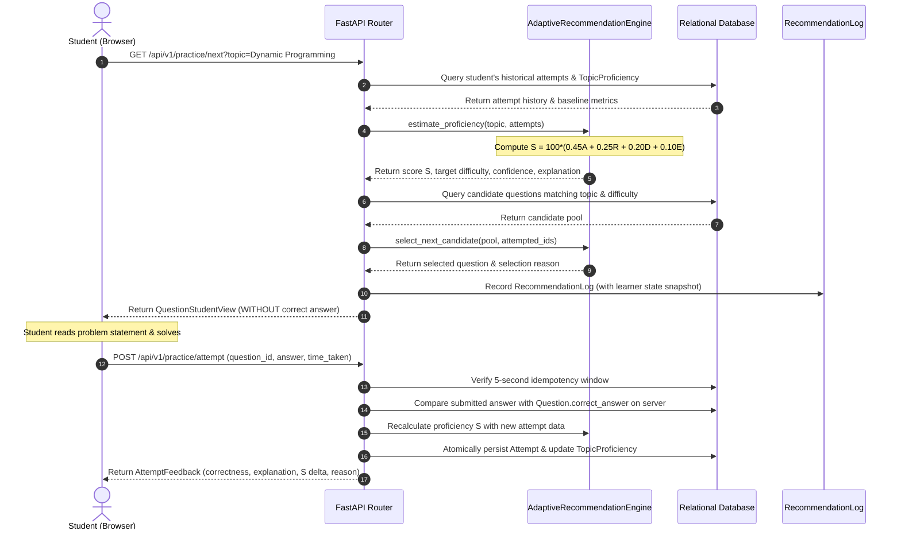

# AdaptivePrep System Architecture

**Project Title:** AdaptivePrep: An Explainable, Performance-Driven Adaptive Learning Platform for Personalized Placement Preparation  
**Institution:** Medi-Caps University, Indore  
**Project Team:** Abhishek Gangrade, Aastha Jain  
**Project Guide:** Prof. HarshPratap Singh  
**Document Version:** 2.0 (Production Verified)  
**Date:** November 17, 2026  

---

## 1. Architectural Overview

AdaptivePrep is designed as a three-tier, service-oriented web application engineered for high explainability, strict data privacy, reproducible mathematical recommendation logic, and research evaluation.

---

## 2. Component Separation & Responsibilities

The codebase enforces strict separation of concerns across presentation, business logic, validation, and data persistence:

### 2.1 Backend Modules (`backend/app/`)
- **`core/`**:
  - `config.py`: Centralized environment configurations via Pydantic `BaseSettings`. Anchors the default SQLite database path (`/Users/apple/Desktop/AdaptivePrep/adaptiveprep.db`) to eliminate path drift.
  - `database.py`: SQLAlchemy 2.0 session factory with transactional connection pool and `get_db` FastAPI dependency.
  - `security.py`: Password hashing using `passlib[bcrypt]` and stateless HMAC-SHA256 JWT access tokens.
  - `dependencies.py`: Role-based authorization dependencies (`get_current_user`, `get_current_admin`).
- **`models/`**:
  - `User`: Student/admin identity, hashed credentials, college, target role, and research consent flags.
  - `Question`: Placement problem statements, options (JSON), correct answer key, solution explanation, topic, subtopic, concept tags, difficulty, version, and lifecycle status (`draft`, `in_review`, `published`, `archived`).
  - `Attempt`: Student submission records, answer selection, correctness, timing metrics, question version, attempt number, started-at timestamp, and idempotency tracking.
  - `TopicProficiency`: Topic-level learner proficiency estimates ($S \in [0, 100]$), component scores ($A, R, D, E$), and confidence classifications (`low`, `moderate`, `high`).
  - `RecommendationLog`: Chronological immutable audit trail of algorithmic recommendations, target difficulty, selection reasons, and learner state snapshots.
  - `PracticeSession`: Study session tracking, question counters, duration, and accuracy metrics.
  - `ResearchStudy`, `ResearchParticipant`, `AssessmentResult`: Research framework models comparing adaptive, accuracy-only, and random question allocation strategies.
- **`schemas/`**:
  - Pydantic v2 schemas for request validation and response filtering.
  - **Privacy Isolation:** `QuestionStudentView` strictly excludes `correct_answer` and `explanation`, ensuring no answer key leakage to the client before submission.
- **`services/`**:
  - `adaptive_engine.py`: Pure, deterministic multi-factor recommendation engine. Implements $S = 100 \times (0.45A + 0.25R + 0.20D + 0.10E)$, Laplace smoothing, recency weighting, difficulty credit, solving efficiency bounds, anti-guessing penalties, and factor ablation.
  - `performance_service.py`: Server-side attempt evaluation, atomic proficiency updating, recommendation audit logging, and 5-second duplicate submission idempotency protection.
  - `question_service.py`: Content querying, lifecycle status transitions, and version incrementing on problem statement revisions.
  - `research_service.py`: Participant allocation to experimental arms (Adaptive vs. Accuracy-Only vs. Random), simulation generation, and pseudonymized research CSV export.
- **`api/routes/`**:
  - Modular routers for `/auth`, `/questions`, `/practice`, `/progress`, `/recommendations`, `/admin`, `/research`.

### 2.2 Frontend Architecture (`frontend/src/`)
- Built on **React 18**, **TypeScript 5**, **Vite 5**, and **Tailwind CSS**.
- **`pages/`**:
  - `Login.tsx` / `Register.tsx`: Authentication flows with role-based redirection.
  - `Dashboard.tsx`: High-level learner KPI summary, weak topic alerts, and recent practice history.
  - `Practice.tsx`: Interactive question solver featuring topic filtering, timing telemetry, answer privacy, instant mathematical feedback, and 4-factor calibration breakdowns.
  - `Progress.tsx`: In-depth topic analytics, Recharts rolling accuracy trends, and difficulty distribution charts.
  - `Settings.tsx`: User profile editing (college, target role), research study consent management, and transparent algorithm parameter inspection.
  - `Admin.tsx`: Question bank curation, version inspection, subtopics, concept tags, and lifecycle status transitions (`draft` $\to$ `in_review` $\to$ `published` $\to$ `archived`).
  - `Research.tsx`: Experimental comparative study dashboard, 3-strategy evaluation charts, and pseudonymized dataset CSV download.
- **`layouts/` & `components/`**:
  - Reusable design system: `DashboardLayout`, `Card`, `Badge`, `LoadingSpinner`, `StatCard`.
- **`services/api.ts`**:
  - Centralized Axios-compatible HTTP client with auto-attached JWT headers, standard error parsing, and intelligent port detection for Vite development (5173) and production reverse proxy (80).

---

## 3. The 12-Step Adaptive Recommendation & Practice Cycle

---

## 4. Security Architecture

1. **Password Storage:** Salted and hashed using `bcrypt` (12 rounds). Plaintext passwords are never persisted.
2. **Stateless Authorization:** Authenticated sessions issue signed HMAC-SHA256 JWT tokens containing `sub` (user ID) and `role`. Protected endpoints enforce role boundaries (`student` vs `admin`).
3. **Answer Key Protection:** Question statements and multiple-choice options are served via `QuestionStudentView`. Ground-truth `correct_answer` and `explanation` remain strictly server-side until an attempt is officially submitted.
4. **Idempotency & Duplicate Prevention:** Identical attempts submitted within 5 seconds for the same question return existing attempt feedback without duplicate calculations or inflated attempt counters.
5. **Rate Limiting:** IP-based sliding window rate limiter protects `/api/v1/auth/login` and `/api/v1/auth/register` (maximum 15 requests per minute per IP, issuing HTTP 429 upon breach).
6. **HTTP Security Headers:**
   - `X-Content-Type-Options: nosniff`
   - `X-Frame-Options: DENY`
   - `Referrer-Policy: strict-origin-when-cross-origin`
   - `X-Process-Time` (audit telemetry)
7. **CORS:** Controlled origin policy allowing local development ports (`localhost:5173`, `127.0.0.1:5173`) and configurable production origins.

---

## 5. Technology Stack Summary

| Layer | Primary Technology | Purpose |
|---|---|---|
| **Frontend Framework** | React 18 + TypeScript | Type-safe single page reactive application |
| **Build & Dev Tool** | Vite 5 | Fast development compilation and optimized Rollup bundling |
| **CSS & Design System** | Tailwind CSS | Clean, responsive placement prep styling (#167D74 theme) |
| **Data Visualizations** | Recharts | Rolling accuracy curves, topic distributions, strategy comparisons |
| **Icons** | Lucide React | Clean, consistent UI iconography |
| **Backend Framework** | FastAPI (Python 3.12/3.14) | High-performance asynchronous REST API with OpenAPI documentation |
| **ORM & Migrations** | SQLAlchemy 2.0 & Alembic | Declarative relational persistence with schema migrations |
| **Database** | PostgreSQL / SQLite | Dual-database design (PostgreSQL production / SQLite local) |
| **Mathematical Computing** | NumPy / Python Standard Math | Deterministic proficiency calculations and statistical aggregations |
| **Testing** | Pytest 9 + HTTPX TestClient | Automated unit, integration, and ablation testing |
