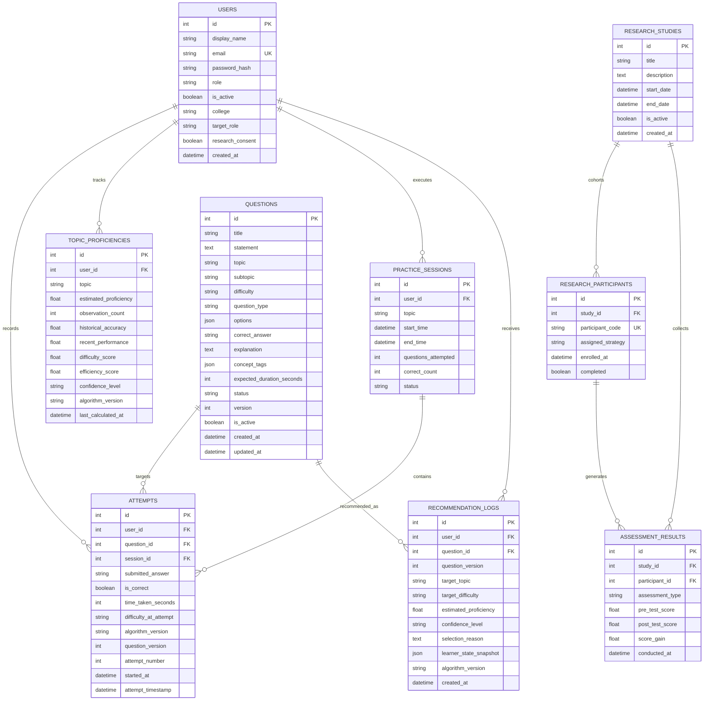

# AdaptivePrep Database Schema Documentation

**Project Title:** AdaptivePrep: An Explainable, Performance-Driven Adaptive Learning Platform  
**Document:** `/docs/DATABASE_SCHEMA.md`  
**Database Engines Supported:** PostgreSQL 16 (Production / Docker) & SQLite 3 (Local Development / Testing)  
**Schema Migration Manager:** Alembic  
**Current Revision:** `09b79c514944`  
**Date:** November 17, 2026  

---

## 1. Entity-Relationship Diagram (ERD)

---

## 2. Table Specifications

### 2.1 `users` Table
Stores authenticated student and administrator identities.
- `id` (INTEGER, PK, Autoincrement)
- `display_name` (VARCHAR(100), NOT NULL)
- `email` (VARCHAR(255), UNIQUE, NOT NULL, INDEXED)
- `password_hash` (VARCHAR(255), NOT NULL) — Salted bcrypt hash
- `role` (VARCHAR(20), NOT NULL, DEFAULT `'student'`) — `'student'` or `'admin'`
- `is_active` (BOOLEAN, NOT NULL, DEFAULT `TRUE`)
- `college` (VARCHAR(150), NOT NULL, DEFAULT `'Medi-Caps University'`)
- `target_role` (VARCHAR(100), NOT NULL, DEFAULT `'Software Development Engineer (SDE)'`)
- `research_consent` (BOOLEAN, NOT NULL, DEFAULT `TRUE`)
- `created_at` (TIMESTAMP WITH TIME ZONE, NOT NULL, DEFAULT `NOW()`)

### 2.2 `questions` Table
Curated placement problem bank with lifecycle status and version tracking.
- `id` (INTEGER, PK, Autoincrement)
- `title` (VARCHAR(200), NOT NULL)
- `statement` (TEXT, NOT NULL)
- `topic` (VARCHAR(50), NOT NULL, INDEXED) — E.g., "Arrays", "Dynamic Programming"
- `subtopic` (VARCHAR(100), NULLABLE) — E.g., "Two Pointers", "Sliding Window"
- `difficulty` (VARCHAR(10), NOT NULL, INDEXED) — `'Easy'`, `'Medium'`, `'Hard'`
- `question_type` (VARCHAR(20), NOT NULL, DEFAULT `'multiple_choice'`)
- `options` (JSON / TEXT, NOT NULL) — Array of 4 option strings
- `correct_answer` (VARCHAR(255), NOT NULL) — Ground-truth string (protected from student view)
- `explanation` (TEXT, NOT NULL) — Step-by-step solution justification
- `concept_tags` (JSON / TEXT, NULLABLE) — Array of string tags (e.g. `["kadane", "array"]`)
- `expected_duration_seconds` (INTEGER, NOT NULL, DEFAULT `90`)
- `status` (VARCHAR(20), NOT NULL, DEFAULT `'published'`, INDEXED) — `'draft'`, `'in_review'`, `'published'`, `'archived'`
- `version` (INTEGER, NOT NULL, DEFAULT `1`) — Incremented automatically upon content revisions
- `is_active` (BOOLEAN, NOT NULL, DEFAULT `TRUE`, INDEXED)
- `created_at` (TIMESTAMP WITH TIME ZONE, NOT NULL, DEFAULT `NOW()`)
- `updated_at` (TIMESTAMP WITH TIME ZONE, NOT NULL, DEFAULT `NOW()`)

### 2.3 `attempts` Table
Immutable record of all student practice submissions.
- `id` (INTEGER, PK, Autoincrement)
- `user_id` (INTEGER, FK $\to$ `users.id`, NOT NULL, INDEXED)
- `question_id` (INTEGER, FK $\to$ `questions.id`, NOT NULL, INDEXED)
- `session_id` (INTEGER, FK $\to$ `practice_sessions.id`, NULLABLE, INDEXED)
- `submitted_answer` (VARCHAR(255), NOT NULL)
- `is_correct` (BOOLEAN, NOT NULL, INDEXED)
- `time_taken_seconds` (INTEGER, NOT NULL) — Clamped between 3s and 1800s
- `difficulty_at_attempt` (VARCHAR(10), NOT NULL)
- `algorithm_version` (VARCHAR(20), NOT NULL, DEFAULT `'v1.0.0'`)
- `question_version` (INTEGER, NOT NULL, DEFAULT `1`) — Ties attempt to question content at submission time
- `attempt_number` (INTEGER, NOT NULL, DEFAULT `1`) — Chronological attempt index for student/question
- `started_at` (TIMESTAMP WITH TIME ZONE, NULLABLE)
- `attempt_timestamp` (TIMESTAMP WITH TIME ZONE, NOT NULL, DEFAULT `NOW()`, INDEXED)

### 2.4 `topic_proficiencies` Table
Maintains continuous topic-level proficiency estimates.
- `id` (INTEGER, PK, Autoincrement)
- `user_id` (INTEGER, FK $\to$ `users.id`, NOT NULL, INDEXED)
- `topic` (VARCHAR(50), NOT NULL, INDEXED)
- `estimated_proficiency` (FLOAT, NOT NULL, DEFAULT `50.0`) — $S \in [0, 100]$
- `observation_count` (INTEGER, NOT NULL, DEFAULT `0`) — Total attempts in topic
- `historical_accuracy` (FLOAT, NOT NULL, DEFAULT `0.5`) — Laplace smoothed $A \in [0, 1]$
- `recent_performance` (FLOAT, NOT NULL, DEFAULT `0.5`) — Recency-weighted $R \in [0, 1]$
- `difficulty_score` (FLOAT, NOT NULL, DEFAULT `0.5`) — Difficulty performance $D \in [0, 1]$
- `efficiency_score` (FLOAT, NOT NULL, DEFAULT `0.5`) — Solving efficiency $E \in [0, 1]$
- `confidence_level` (VARCHAR(20), NOT NULL, DEFAULT `'low'`) — `'low'` ($n<3$), `'moderate'` ($3\le n < 7$), `'high'` ($n\ge 7$)
- `algorithm_version` (VARCHAR(20), NOT NULL, DEFAULT `'v1.0.0'`)
- `last_calculated_at` (TIMESTAMP WITH TIME ZONE, NOT NULL, DEFAULT `NOW()`)
- **Constraint:** Unique composite constraint on `(user_id, topic)`.

### 2.5 `recommendation_logs` Table
Persistent audit log capturing algorithmic recommendations and learner snapshots.
- `id` (INTEGER, PK, Autoincrement)
- `user_id` (INTEGER, FK $\to$ `users.id`, NOT NULL, INDEXED)
- `question_id` (INTEGER, FK $\to$ `questions.id`, NOT NULL, INDEXED)
- `question_version` (INTEGER, NOT NULL, DEFAULT `1`)
- `target_topic` (VARCHAR(50), NOT NULL)
- `target_difficulty` (VARCHAR(10), NOT NULL)
- `estimated_proficiency` (FLOAT, NOT NULL)
- `confidence_level` (VARCHAR(20), NOT NULL)
- `selection_reason` (TEXT, NOT NULL)
- `learner_state_snapshot` (JSON / TEXT, NULLABLE) — Stores $\{A, R, D, E, n\}$ snapshot
- `algorithm_version` (VARCHAR(20), NOT NULL, DEFAULT `'v1.0.0'`)
- `created_at` (TIMESTAMP WITH TIME ZONE, NOT NULL, DEFAULT `NOW()`, INDEXED)

### 2.6 `research_studies`, `research_participants`, `assessment_results`
Stores experimental study design, participant assignments across 3 conditions (`adaptive`, `accuracy_only`, `random`), pre- and post-test scores, and score gain metrics.

---

## 3. Migration History (Alembic)

| Revision ID | Description | Operations | Date |
|---|---|---|---|
| `0008ce4ad819` | Initial relational schema | Created `users`, `questions`, `attempts`, `topic_proficiencies`, `practice_sessions`, `research_*` | Oct 2026 |
| `09b79c514944` | Production enhancement migration | Added `recommendation_logs`, question lifecycle (`status`, `subtopic`, `concept_tags`, `version`), attempt metadata (`question_version`, `attempt_number`, `started_at`), user profile fields (`college`, `target_role`, `research_consent`) | Nov 17, 2026 |
